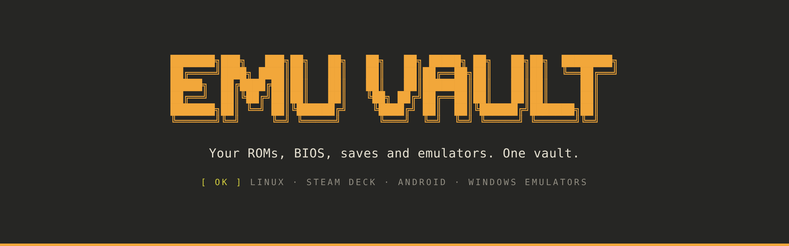
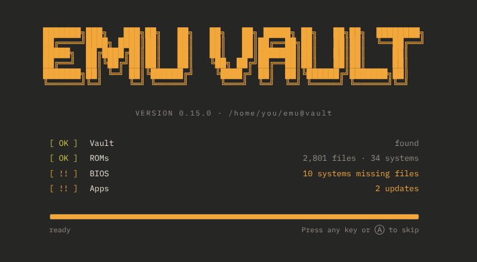
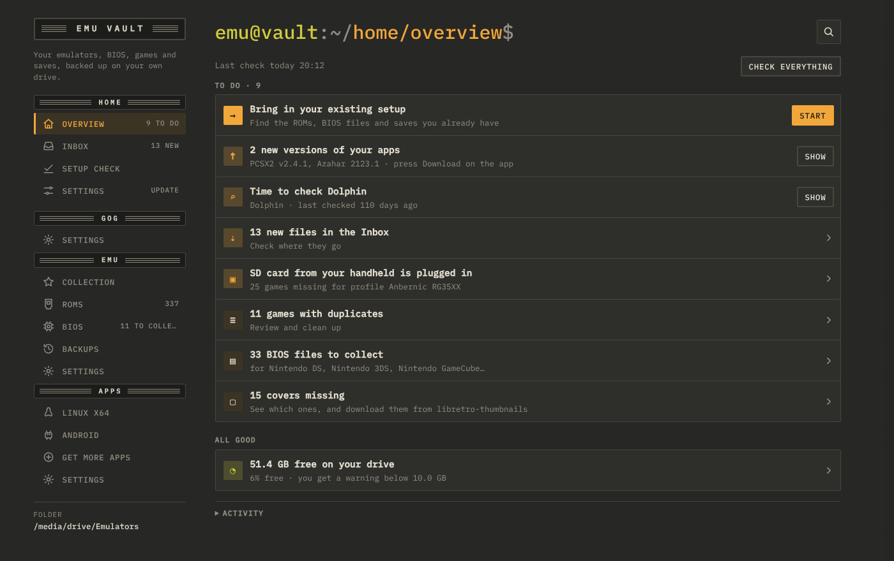
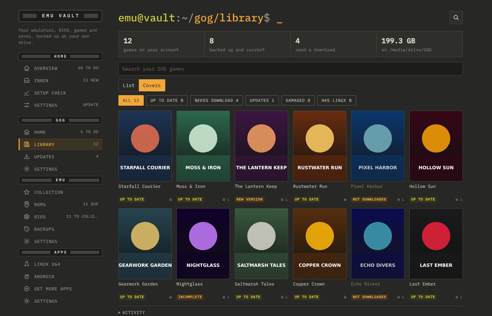
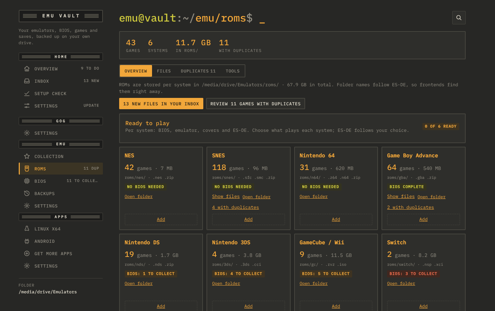
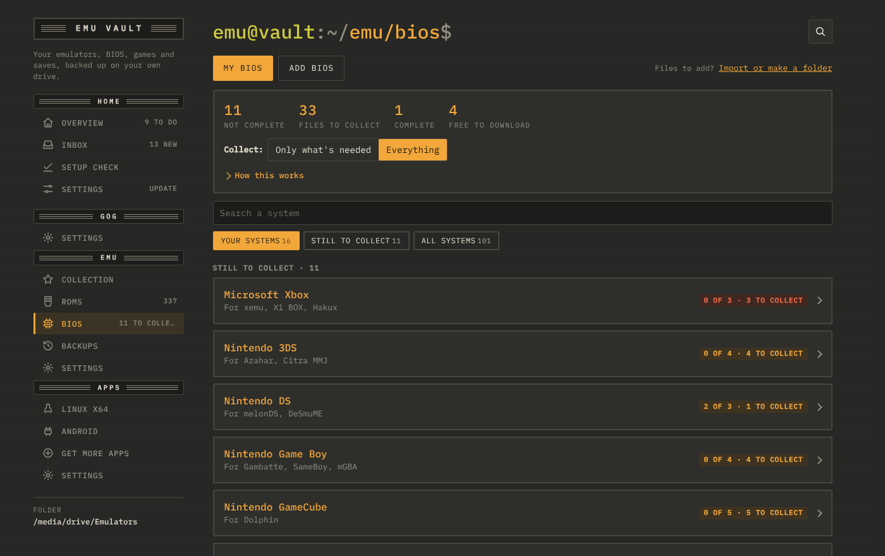
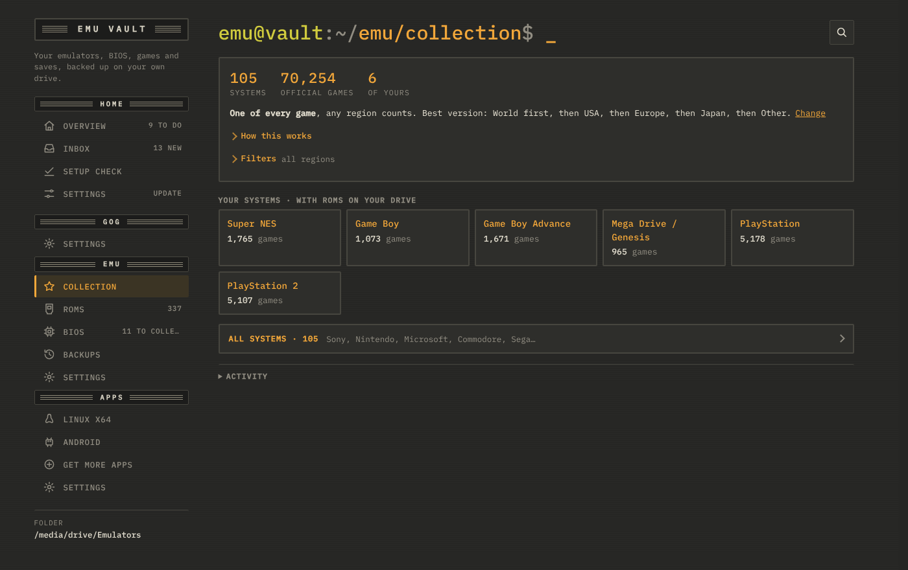

<p align="center">
  
</p>

<p align="center">
  A desktop app for Linux and Steam Deck that keeps your whole retro gaming setup in one folder on your own drive.
</p>

<p align="center">
  <a href="../../releases/latest"><b>Download the latest release</b></a> ·
  <a href="#install">Install</a> ·
  <a href="#what-it-does">What it does</a> ·
  <a href="#gog-backup">GOG backup</a> ·
  <a href="#the-vault">The vault</a>
</p>

---

## Why Emu Vault

Retro gaming spreads out fast: ROMs in one place, BIOS files in another, saves inside every emulator, emulators downloaded from a dozen GitHub pages, and a second copy of all of it on your handheld.

Emu Vault puts it back together. Everything lives in **one folder** (your vault) that you can copy, back up or carry on an external drive. Emu Vault sorts what you drop in, checks what's missing and keeps your emulators up to date, for your PC, your Android handheld and your Windows machine.

<p align="center">
  
</p>

## What it does

| | |
| --- | --- |
| **Sorts your games** | Drop files in the Inbox. Emu Vault recognizes ROMs, BIOS files and saves and moves each one to the right folder. Duplicates are found and set aside, with your region preference. |
| **Checks your BIOS** | Per system you see which BIOS files you have and which are missing, verified by md5. Import a whole folder and Emu Vault puts every file in place, even with the wrong name. |
| **Keeps emulators current** | Linux, Windows (x64 and ARM) and Android builds of your emulators, straight from GitHub releases, official websites and the libretro buildbot. |
| **Knows your collection** | Compares your games with No-Intro, Redump and FinalBurn Neo, so you see what you have and what's still missing. |
| **Backs up your saves** | Per emulator, on a schedule you choose. |
| **Keeps your GOG games** | A full, verified backup of the GOG games you own: installers, extras and DLC. [More below](#gog-backup). |
| **Works with your frontend** | Sets up ES-DE and RetroArch to use your vault, with a Setup check that tells you what points where. |

<p align="center">
  
</p>

## GOG backup

The games you bought on GOG are yours, DRM-free. Emu Vault keeps a full copy of them on your own drive, so you still have every installer when you're offline, when a download link changes, or when a game leaves the store.

- **Sign in with your GOG account** and see your whole library, as a list or as covers.
- **Installers for Windows, Linux and macOS**, the systems you pick, in your language (English when a game doesn't have it).
- **Extras, DLC and patches** too: soundtracks, manuals, artbooks and the small update files between versions.
- **Downloads that pick up where they stopped.** Pause and stop whenever you like.
- **Checked by MD5.** *Check files now* verifies that every file is still complete and intact.
- **New versions found for you.** Daily, weekly or at startup, Emu Vault checks GOG and tells you which games have an update.
- **Your saves per game**, including cloud saves, next to the installers.
- **Same layout as gog-downloader**, so both tools can share one folder. An external drive works fine.

To play, install the games with GOG Galaxy or Heroic. Emu Vault is the safe copy behind them.

<p align="center">
  
</p>
<p align="center"><sub>Example library with made-up games.</sub></p>

## Install

Every release has these files. You need one.

| File | For |
| --- | --- |
| `emu-vault-<version>.sh` | **Most people on Linux.** Standalone, runs on any Linux and Steam Deck. Includes chdman and xdelta3. |
| `emu-vault-lite-<version>.sh` | The same without chdman and xdelta3, if you install those yourself. |
| `emu-vault_<version>_amd64.deb` | Debian, Ubuntu, Linux Mint and other .deb systems. |
| `emu-vault-<version>-windows-portable.exe` | **Windows 10 and 11, early version.** No install: just start it. Starting games and emulators, sorting BIOS files from a folder and updating itself still need Linux; the app tells you when you reach one of those. |

```sh
chmod +x emu-vault-0.16.4.sh
./emu-vault-0.16.4.sh
```

**On a USB stick.** Put the Windows `.exe` and the Linux `.sh` side by side on a stick. The `.exe` makes a folder `emu-vault-data` next to itself, and the `.sh` uses that folder too when it's there, so both share your settings and your GOG login. The folders (your vault, your GOG folder) are remembered per computer, because the stick and your drives get different names on every PC.

On first start you pick your vault folder and the devices you play on (Linux PC, Windows PC, Android). Emu Vault looks at your games and suggests one good emulator per system.

## The vault

Plain folders, readable without Emu Vault. Folder names follow ES-DE, so frontends find everything right away.

```
emu@vault/
├── inbox/              drop new files here
├── roms/<system>/      your games, like roms/ps2/ and roms/snes/
├── bios/<system>/      BIOS per system, like bios/ps2/ and bios/ps4/sys_modules/
├── RetroArch-BIOS/     your BIOS in RetroArch's layout
├── Apps/<app>/<platform>/   emulators, like Apps/Dolphin/Android/
├── media/              covers (shared with ES-DE)
├── patches/            translations and fixes
└── Backups/saves/      save backups per emulator and date
```

## A closer look

<table>
  <tr>
    <td width="50%"></td>
    <td width="50%"></td>
  </tr>
  <tr>
    <td><b>ROMs</b>: your systems at a glance, with BIOS status, duplicates, CHD/RVZ conversion and patches.</td>
    <td><b>BIOS</b>: what's ready and what's still to collect, for the systems you actually play.</td>
  </tr>
</table>

<p align="center">
  
</p>

## Good to know

- **Your files stay yours.** Emu Vault never uploads your games, BIOS or saves anywhere. Everything it moves shows up in Recent changes, with Undo.
- **No ROMs or BIOS included.** Emu Vault organizes the files you own; it doesn't provide them.
- **Updates itself.** Emu Vault checks this page for a new release on startup and installs it with one click, keeping your vault and settings. You can turn the check off.
- **Controller friendly.** Move through the app with a gamepad, handy on the Steam Deck.

## Credits

The app catalog uses the [Obtainium Emulation Pack](https://github.com/RJNY/Obtainium-Emulation-Pack) and [awesome-emulators](https://github.com/DerekTurtleRoe/awesome-emulators) (CC BY-NC-SA 4.0). Game lists come from No-Intro, Redump and FinalBurn Neo through [libretro-database](https://github.com/libretro/libretro-database). RetroArch builds come from the [libretro buildbot](https://buildbot.libretro.com/).
